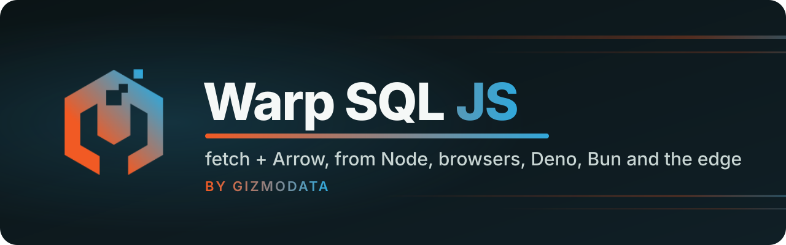

<p align="center">
  <a href="https://github.com/gizmodata/warp-sql">
    
  </a>
</p>

<p align="center">
  <a href="https://github.com/gizmodata/warp-sql"></a>
  
  <a href="https://arrow.apache.org/docs/js/"></a>
  
  
  
  <br>
  <a href="https://github.com/gizmodata/hardcharger"></a>
  <a href="LICENSE"></a>
  <a href="https://gizmodata.com"></a>
</p>

<h3 align="center">Query any Warp SQL server from JavaScript with plain <code>fetch</code>. Get Arrow back.</h3>

---

## 🔌 What is it?

`@gizmodata/warp-sql` is a TypeScript client for the [Warp SQL protocol](https://github.com/gizmodata/warp-sql):
SQL over plain HTTP, with results, parameters and uploads as Apache Arrow IPC streams. It
talks to any Warp SQL server, such as [Hardcharger](https://github.com/gizmodata/hardcharger) or
the reference server `warp-duckdb`.

- 🌍 **Runs everywhere `fetch` does:** Node, browsers, Deno, Bun and Cloudflare Workers. No native
  code, no ADBC, no gRPC.
- 🏹 **Arrow end to end:** results arrive as [`apache-arrow`](https://arrow.apache.org/docs/js/)
  Tables or streams of RecordBatches, read off the network as you ask for them.
- 🌐 **Built for real networks:** resumable downloads, retries that never run a statement twice
  (`Idempotency-Key`), token renewal, replacement of lost sessions, and results split over
  several connections at once.
- 🛑 **Cancel that really cancels:** an `AbortSignal` stops the statement on the server.
- ✅ **Never a short table:** a result stream that ends without Arrow's end-of-stream marker
  throws; it is never taken for a complete result.

> **Status: internal, unreleased (0.1.0).** Tested against `warp-duckdb` (warp-sql main) and
> Hardcharger 0.2.0. Not published to npm.

## 🚀 Quick start (Node)

From [examples/node/quickstart.mjs](examples/node/quickstart.mjs), run against both servers:

```js
import { tableFromArrays } from "apache-arrow";
import { WarpSqlError, connect } from "@gizmodata/warp-sql";

const conn = await connect({
  url: process.env.WARP_URL,
  username: process.env.WARP_USER,
  password: process.env.WARP_PASSWORD,
});

// A query, with bind parameters: an Arrow Table back.
const table = await conn.query("SELECT 42 AS answer, ?::VARCHAR AS greeting", ["hello"]);
console.log(table.toArray().map((row) => row.toJSON()));

// A big result, streamed batch by batch.
let rows = 0;
for await (const batch of conn.stream("SELECT * FROM range(10000000)")) rows += batch.numRows;
console.log(`streamed ${rows} rows`);

// Bulk ingest from Arrow, then a prepared statement run once per row.
await conn.ingest("events", tableFromArrays({ id: Int32Array.from([1, 2, 3]) }), { mode: "replace" });
const insert = await conn.prepare("INSERT INTO events VALUES (?)");
console.log(`inserted ${await insert.executeBatch([[4], [5]])} rows`);

// Errors carry the server's code; an AbortSignal cancels the statement on the server.
try {
  await conn.query("SELECT sum(a.range * b.range) FROM range(100000000) a, range(100000) b", undefined, {
    signal: AbortSignal.timeout(1000),
  });
} catch (err) {
  if (!(err instanceof WarpSqlError)) throw err;
  console.log(`${err.code}: ${err.message}`);
}

await conn.close();
```

```text
[ { answer: 42, greeting: 'hello' } ]
streamed 10000000 rows
inserted 2 rows
statement_timeout: the operation timed out (its AbortSignal fired)
```

## 🖥️ In the browser

[examples/browser](examples/browser) is a small page that signs in, runs SQL and streams the result
into a table. Its script is plain client code (bundled by esbuild, which picks the package's
browser build through its export conditions):

```js
// From examples/browser/main.mjs (the password goes in a JSON body, never in a URL):
connection = await connect({ url, username, password: $("password").value });
const stream = connection.stream($("sql").value, undefined, { signal: running.signal });
const schema = await stream.schema();
for await (const batch of stream) {
  total += batch.numRows;
  for (const row of batch) if (rows.length < 1000) rows.push(row.toJSON());
}
```

Run it against a local server that allows the page's origin:

```bash
WARP_DUCKDB_PASSWORD=… warp-duckdb --port 31337 --username joe --cors-origin http://localhost:5173
# or: HARDCHARGER_ADMIN_PASSWORD=… hardcharger-server --port 31337 --admin-username joe --cors-origins http://localhost:5173
npm run build && npm run example:browser   # http://localhost:5173/?url=http://127.0.0.1:31337&username=joe
```

Browsers keep their own rules, which the browser build follows: certificates come from the
system's trust store (no `tls` options), uploads are sent whole (browsers stream request bodies
only over HTTP/2, Safari not at all), and results are split into at most 4 partitions by default
(browsers and Workers allow about six connections per host over HTTP/1.1, and a split result needs
one per partition). Credentials are bearer tokens in a header, never cookies, so cross-origin
access needs only the server's CORS allow-list (and, for a client certificate, see below).

## 🦕 Deno, Bun and Cloudflare Workers

The package's export conditions pick its build: `node` (Node, Deno, Bun: TLS options, streamed
uploads, 8 partitions) or `default` (browsers and edge runtimes). The smoke tests run the same
script, [test/smoke/smoke.mjs](test/smoke/smoke.mjs), under Node, Deno and Bun, and a Worker,
[test/smoke/worker.mjs](test/smoke/worker.mjs), in workerd (Cloudflare's runtime, through
Miniflare).

## 🔗 Connecting

| URL                              | Meaning                                                      |
| -------------------------------- | ------------------------------------------------------------ |
| `warp://host:port`               | HTTPS, base path `/warp` (the default)                       |
| `warp://host:port/custom/prefix` | HTTPS, the server mounts the protocol under `/custom/prefix` |
| `warp://host:port?tls=false`     | Plain HTTP (development, loopback)                           |
| `https://host:port[/prefix]`     | Same as `warp://`                                            |
| `http://host:port[/prefix]`      | Plain HTTP                                                   |

A URL with credentials in it is refused. For Hardcharger™, use
[`@gizmodata/hardcharger`](https://github.com/gizmodata/hardcharger-js): this client with
`hardcharger://` URLs (port 31337 unless the URL names one) and Hardcharger names for its classes,
as a thin package that depends on this one and re-exports it. This package stays the generic
client for any Warp SQL server. Another wrapper can add a scheme of its own by passing
`schemes: { ...defaultSchemes, myscheme: { tls: true, tlsParameter: true, defaultPort: 4000 } }`.

`connect` takes exactly one credential:

| Option                                  | Grant                                                                                                                |
| --------------------------------------- | -------------------------------------------------------------------------------------------------------------------- |
| `username`, `password`                  | `password` (§4.1); any character, `:` and `@` included                                                               |
| `token`                                 | A Warp SQL access token issued elsewhere, used as is and never renewed                                               |
| `tokenProvider`                         | A function returning a fresh access token, called at connect and whenever the server refuses the current one         |
| `subjectToken`                          | An identity provider's token (string or function) for the `token_exchange` grant (SSO)                               |
| `authType: "client_certificate"`        | The TLS client certificate alone, no password (§4.4); see [Client certificate sign-in](#-client-certificate-sign-in) |
| `authType: "oauth_browser"` + `openUrl` | Browser sign-in with the server's identity provider (§4.3); see [Browser sign-in](#-browser-sign-in-sso)             |

Other `connect` options:

| Option                                                                                                         | Default        | Meaning                                                                                             |
| -------------------------------------------------------------------------------------------------------------- | -------------- | --------------------------------------------------------------------------------------------------- |
| `catalog`, `schema`, `sessionOptions`                                                                          |                | The session's options (§5.3), replayed on a replacement session                                     |
| `tls`                                                                                                          | system         | Node, Deno, Bun: `{ ca, cert, key, servername, skipVerify }` (PEM text)                             |
| `fetch`                                                                                                        | global         | Your own `fetch` (not together with `tls`)                                                          |
| `fetchCredentials`                                                                                             | runtime's      | fetch's credentials mode; `"include"` by default in a browser with `authType: "client_certificate"` |
| `maxAttempts`                                                                                                  | `4`            | Sends of a request that is safe to repeat, first included                                           |
| `reconnect`                                                                                                    | `true`         | Replace a session the server lost                                                                   |
| `resultBufferBytes`                                                                                            | 128 MiB        | How much of an unread stream may be read ahead when the session is needed for something else        |
| `logger`                                                                                                       | `console.warn` | `{ debug, warn }`; session replacements are warnings                                                |
| `async`, `retainResult`, `statementTimeoutMs`, `queryTag`, `ipcCompression`, `resultPartitions`, `resultOrder` |                | Defaults for every statement (below)                                                                |

## 🔐 Client certificate sign-in

On a server that offers it (capability `mtls_identity`: Hardcharger with
`mtls_certificate_sign_in`, warp-duckdb with `--mtls-certificate-sign-in`), the TLS client
certificate is the credential: the client sends the `client_certificate` grant with no password,
and the server maps the certificate's identity (by default its e-mail SAN) to a user. In Node, Deno
and Bun the certificate is `tls.cert` and `tls.key`:

```js
import { readFileSync } from "node:fs";

import { WarpSqlError, connect } from "@gizmodata/warp-sql";

const conn = await connect({
  url: "warp://db.example.com:31337",
  authType: "client_certificate",
  tls: {
    ca: readFileSync("ca.pem", "utf8"),
    cert: readFileSync("client.pem", "utf8"),
    key: readFileSync("client-key.pem", "utf8"),
  },
});
console.log((await conn.query("SELECT HARDCHARGER_USER() AS who")).getChild("who").get(0)); // ops@example.com
```

The token the server issues is bound to the certificate (RFC 8705), and renewed with the same
grant. Every request goes through the connection's one undici dispatcher, which presents the
certificate on every connection it opens, so the partitions of a split result, read at once over
connections of their own, carry it too. The client refuses, before sending anything, a username,
password or token beside it, a plain-HTTP URL, and (in Node) a missing `tls.cert`/`tls.key`; and,
after discovery, a server that does not list `mtls_identity` and the grant (`not_implemented`).

In a browser the certificate is the one the user picks from the browser's store, so there are no
`tls` options: the client sends every request with `credentials: "include"`, without which a
browser presents no certificate on a cross-origin request.

```js
const conn = await connect({ url: "https://db.example.com:31337", authType: "client_certificate" });
```

On another origin than the server's, that needs the server to allow credentials for the page's
origin (`Access-Control-Allow-Credentials`, spec §9.5), which the warp-sql SDK does from its
`feat/cors-credentials` branch on (not yet in a released server), and certificates optional at the
handshake, because CORS preflights carry no credentials. A page served by the server itself
(Hardcharger's UI) needs neither.

The server's refusals keep their spec codes (§4.4), each a `401`:

| Code                            | When                                                                                        |
| ------------------------------- | ------------------------------------------------------------------------------------------- |
| `certificate_required`          | No certificate on the connection (a server where certificates are optional)                 |
| `unknown_certificate_identity`  | The certificate's identity is missing, ambiguous, or not a user allowed to sign in this way |
| `certificate_revoked`           | Revoked, or no longer verifying, after the connection was set up                            |
| `certificate_mismatch`          | A certificate-bound token over a connection without that certificate                        |
| `certificate_identity_mismatch` | A password or token sign-in for another identity than the connection's certificate          |

```js
try {
  await connect({ url, authType: "client_certificate", tls: { ca, cert: otherCert, key: otherKey } });
} catch (err) {
  if (WarpSqlError.is(err, "unknown_certificate_identity")) console.log(err.code, err.status); // ... 401
}
```

## 🌐 Browser sign-in (SSO)

A server with the capability `oauth_browser` signs people in with its identity provider
(spec §4.3). The server is the provider's client, so the application needs no client id,
secret or redirect handling: it creates a flow, the person signs in in a browser, and the
client collects the server's own access token with the flow's poll secret, which is never
put in a URL or logged. `browserSignInProvider(discovery)` gives the provider's name for a
"Sign in with …" button.

From Node or a desktop app, `openUrl` opens (or shows) the sign-in URL:

```ts
import { exec } from "node:child_process";
import { connect } from "@gizmodata/warp-sql";

const conn = await connect({
  url: "warp://db.example.com:31337",
  authType: "oauth_browser",
  openUrl: (url) => void exec(`open ${JSON.stringify(url)}`), // or print it for the person
  browserSignInTimeoutMs: 300_000,
});
```

The connection waits for the sign-in, then uses the token; when the token nears its expiry
the next request runs a new browser sign-in. `browserSignIn({ url, openUrl })` does the same
without a connection and returns `{ accessToken, expiresIn }`.

A web page goes to the provider and comes back to itself (`returnTo`, a path on the server's
own origin): `beginBrowserRedirectSignIn` keeps the flow's poll secret in this tab's
`sessionStorage` and sends the browser away; on the way back, `completeBrowserRedirectSignIn`
reads the flow id from the URL fragment (`#warp_oauth_flow=…`), removes it from the address
bar and collects the token. A flow this tab did not start is ignored.

```ts
import { beginBrowserRedirectSignIn, completeBrowserRedirectSignIn, connect } from "@gizmodata/warp-sql";

const url = "https://db.example.com:31337";
const signedIn = await completeBrowserRedirectSignIn({ url }); // undefined unless coming back
if (signedIn === undefined) {
  await beginBrowserRedirectSignIn({ url, returnTo: location.pathname }); // leaves the page
} else {
  const conn = await connect({ url, token: signedIn.accessToken });
}
```

The steps are also there one by one: `startBrowserSignIn` (→ `flowId`, `pollSecret`,
`authorizeUrl`, `pollIntervalS`, `expiresAt`), `pollBrowserSignIn` (→ `pending` or
`complete`) and `takeBrowserSignInFlowId(url)`. A failed sign-in throws a `WarpSqlError` with
the flow's code: `access_denied` (the person or the provider refused), `invalid_credentials`
(the server does not let that user in), `identity_provider_error`; a flow that expired or was
already collected, or a wrong poll secret, is `flow_not_found`, and a `returnTo` that is not a
path on the server is `invalid_return_to`. A failed flow's code has no `status` (the poll answer itself was a `200`), a
code a later version adds is kept as sent, and a flow state the client doesn't know counts as
`pending` (§12). A sign-in not completed within its timeout is `client_sign_in_timeout`.

## 🧭 API

| Call                                                                                                                                                         | Returns                                                                                                                             |
| ------------------------------------------------------------------------------------------------------------------------------------------------------------ | ----------------------------------------------------------------------------------------------------------------------------------- |
| `connect(options)`                                                                                                                                           | `Connection`                                                                                                                        |
| `conn.query(sql, params?, options?)`                                                                                                                         | `arrow.Table` (an empty one for DDL/DML)                                                                                            |
| `conn.stream(sql, params?, options?)`                                                                                                                        | `ResultStream`: `for await` over RecordBatches; `schema()`, `statementId`, `rowsAffected()`, `partitions()`, `toTable()`, `close()` |
| `conn.execute(sql, params?, options?)`                                                                                                                       | rows changed, or `null` when the engine does not count                                                                              |
| `conn.prepare(sql)`                                                                                                                                          | `PreparedStatement`: `query`, `stream`, `execute`, `executeBatch(rows)`, `parameterSchema`, `resultSchema`, `resultKind`, `close()` |
| `conn.ingest(table, data, { mode, catalog, schema, temporary })`                                                                                             | rows written; `data` is a Table, a RecordBatch or an (async) iterable of batches                                                    |
| `conn.metadata.catalogs()`, `dbSchemas()`, `tables()`, `tableTypes()`, `primaryKeys()`, `importedKeys()`, `exportedKeys()`, `crossReference()`, `typeInfo()` | `arrow.Table` with Flight SQL's schema (§10)                                                                                        |
| `conn.metadata.columns({ … })`                                                                                                                               | `ColumnInfo[]`: name, Arrow field, type name, nullability, precision, scale, default                                                |
| `conn.metadata.serverInfo()`                                                                                                                                 | the server-info document (`ServerInfo`: `server_name`, `server_read_only`, …; a missing key is unknown)                             |
| `conn.transaction(async (tx) => …)`                                                                                                                          | commits, or rolls back on a throw                                                                                                   |
| `conn.setAutocommit(bool)`, `commit()`, `rollback()`, `setOptions({…})`, `getSession()`                                                                      |                                                                                                                                     |
| `conn.transactionState()`                                                                                                                                    | `"none"`, `"open"` or `"aborted"` (§5.2), as the engine has it; `"unknown"` for a value a later version adds                        |
| `conn.close()`                                                                                                                                               | ends the session; or `await using conn = await connect(…)` (Node 24+, Deno, Bun)                                                    |

Parameters are values, never SQL text. An array binds positionally (`?`, `$1`), an object by
name (`$name`), as JSON (a `bigint` is sent exactly). For exact types (dates, decimals, binary,
nested values) pass Arrow data (each row is one execution) or use `prepared.executeBatch(rows)`,
which converts plain values to the server's parameter types.

Statement options, per call or as `connect` defaults:

| Option               | Default                | Meaning                                                                                  |
| -------------------- | ---------------------- | ---------------------------------------------------------------------------------------- |
| `signal`             |                        | An `AbortSignal`: cancels the statement on the server too                                |
| `async`              | `false`                | Submit, long-poll, then fetch a retained result: no request stays open for a whole query |
| `retainResult`       | server's               | `true` keeps the result on the server so a broken download resumes                       |
| `statementTimeoutMs` |                        | The server cancels the statement after this long (§6.9)                                  |
| `queryTag`           |                        | A JSON object the server may record (sent as ASCII JSON, at most 4,096 bytes)            |
| `resultPartitions`   | 8 (Node), 4 (browsers) | Read up to this many partitions of a result at once (§6.10); `1`: one stream             |
| `resultOrder`        | `preserve`             | `any` lets a split result come back in any row order                                     |
| `ipcCompression`     | `none`                 | `lz4_frame`, `zstd` or `auto`: compressed Arrow buffers in results (§8.2, below)         |

## 🧠 How it behaves

- **Queries** stream in the answer to one `POST` (§6.1). Statements without rows answer with their
  document, so `query` returns an empty table and `execute` the count. With `async`, the client
  submits, long-polls the status (§6.3) and fetches the retained result.
- **Never a short table.** Every Arrow stream is checked for its end-of-stream marker. A stream that
  stops without it throws: the statement's own error if it failed (§6.6), `client_incomplete_stream`
  otherwise. A retained result resumes from the next batch first (up to five times); an unretained
  one cannot, and the error says to use `retainResult` or `async`.
- **Split results** (§6.10). On a server with `result_partitions`, the client asks for up to 8
  partitions (4 in browsers), reads them all at once over separate connections with two batches of
  buffering each, and merges them: round robin for `preserve` (so `ORDER BY` holds), as they arrive
  for `any`. Any partition failing fails the whole result; cancelling or closing stops them all. A
  server without the capability never sees the headers. A split answer without `Warp-Result-Order`
  (or a document without `partition_order`) is a `client_protocol_error`, never guessed. Partitions
  on other servers (§6.2, capability `result_locations`) are read at once with the rest; the client
  sends `Warp-Result-Locations: remote` only to a server that lists the capability.
- **Retries.** Every submit, prepared execute and ingest carries an `Idempotency-Key`, so a request
  whose answer was lost is sent again without running twice (§6.7). Reads, deletes and keyed writes
  are retried after transport errors and 421/429/502/503/504, honouring `Retry-After`. Commit and
  rollback are never retried. Uploads up to 16 MiB are held in memory so they can be retried;
  larger ones stream (Node, Deno, Bun) and are sent once.
- **Tokens** are renewed before they expire and, once, when the server refuses one with
  `invalid_token` without a reason, with `token_expired` or with a reason the client doesn't know.
  After `token_revoked`, `credentials_changed` or `principal_dropped` (§4.2) the client does not sign
  in again on its own: the error carries the `reason`.
- **Lost sessions** (`session_not_found`, or `session_ended` for an expired token when the client
  can get a new token, which it does first) are replaced by a
  new session with the options the client set, and the loss is reported, not hidden: a warning,
  `conn.sessionReplacements`, and errors from work on the replacement say so. Inside a transaction
  nothing runs on the replacement (it would commit half a transaction). A prepared statement is
  prepared again. With `reconnect: false` the connection stays broken.
- **Cancel.** An aborted signal cancels the statement by id (`POST …/cancel`). When the answer with
  the id has not arrived, the client cancels the session's work if this is the connection's only
  statement, and otherwise learns the id by resending the request with its `Idempotency-Key`, which
  does not run it twice (§6.8). `AbortSignal.timeout()` reports `statement_timeout`.
- **Done with a result.** Reading to the end, breaking out of `for await`, or `close()` deletes the
  statement on the server (§6.8): a query still running stops, a write finishes with its rows
  discarded.
- **One session, several results.** A server may hold other work on a session until a streaming
  result has been read (Hardcharger 0.2 does). Before the session does anything else, the client
  reads what open streams still hold into memory, up to `resultBufferBytes`; a bigger rest is
  dropped, and reading on raises `client_result_buffer_exceeded`.
- **Partitioned uploads** (spec §8.3, one ingest over several connections) are not implemented yet:
  `ingest` sends one stream (§8.1).
- **Open enumerations** (§12). A statement state the client doesn't know is not final (it keeps
  polling), an unknown `reason` or `cancel_reason` is kept as sent, an unknown session `transaction`
  reads as `"unknown"`, and an unknown error code is judged by its HTTP status.
- **Capabilities.** Nothing the server's discovery document does not list is used: prepared
  statements, ingest, transactions, partitions and compression fail with `not_implemented` or stay
  off.

## ⚠️ Errors

Every error is a `WarpSqlError` with a stable `code`: the server's problem-document code (§11),
or one of the client's own, which begin with `client_` (servers never send those). Decide on
`code`, never on `title` or `detail`. It also carries `status`, `sqlstate`, `detail`, `requestId`,
`statementId` (also on a statement that failed or was cancelled before its submit was answered),
`reason` (on `invalid_token` and `session_ended`) and `cancelReason`.

```js
try {
  await conn.query("SELEC 1");
} catch (err) {
  if (WarpSqlError.is(err, "sql_error")) console.log(err.status, err.requestId, err.detail);
}
```

| Client code                     | When                                                                            |
| ------------------------------- | ------------------------------------------------------------------------------- |
| `client_invalid_argument`       | An argument the client refuses before sending anything                          |
| `client_transport_error`        | No HTTP answer (refused, reset, a certificate the client does not trust)        |
| `client_protocol_error`         | An answer that does not follow the protocol, or a server that is not Warp SQL   |
| `client_http_error`             | An error answer without a problem document (a proxy's page); see `status`       |
| `client_incomplete_stream`      | A result stream ended without its end-of-stream marker and could not be resumed |
| `client_result_buffer_exceeded` | A stream set aside for another request did not fit `resultBufferBytes`          |
| `client_connection_closed`      | The connection was closed                                                       |
| `client_sign_in_timeout`        | A browser sign-in (§4.3) the person did not complete in the time allowed        |

A TLS alert `certificate_required` or `certificate_revoked` (a server refusing the client
certificate at the handshake, §4.4) is reported with that code, not as `client_transport_error`.

## 🗜️ Compression

With `ipcCompression` the server may compress result buffers with Arrow's own IPC compression
(§8.2). The client sends the chosen codec in `Warp-IPC-Compression` on every request that returns
Arrow, each partition's included, and uses a codec only when the server lists its capability
(`ipc_compression_lz4_frame`, `ipc_compression_zstd`); otherwise results come uncompressed.

| Value       | Codec                                                                                        |
| ----------- | -------------------------------------------------------------------------------------------- |
| `none`      | The default: decoding runs on the thread that reads the result, a browser's main thread too  |
| `lz4_frame` | Arrow's LZ4_FRAME: a fraction of zstd's CPU, larger. For fast links                          |
| `zstd`      | Arrow's ZSTD: smaller, slower to decode. For links where bandwidth is scarcer than CPU       |
| `auto`      | `lz4_frame` when the discovery request's round trip is under 10 ms, else `zstd` (as Go ADBC) |

`auto` times `GET /warp` to its response headers. That first request also opens the connection
(TCP and TLS handshakes), so when it takes 10 ms or more, the client times one more discovery request
on the open connection and keeps the shorter time.

Arrow JS reads compressed IPC buffers through a codec registry but ships no codecs. The client
registers its own, each loaded only when a connection uses it (a codec the application registered
already is kept):

- **LZ4_FRAME**: a dependency-free LZ4 frame decoder in this package (3.7 KiB minified). It reads
  linked and independent blocks of any size, stored blocks, content size, and concatenated and
  skippable frames, and verifies the header, block and content checksums when a frame has them
  (Arrow C++ writes none).
- **ZSTD**: [fzstd](https://github.com/101arrowz/fzstd), pure JavaScript. Arrow JS 21 hands a codec's
  output straight to typed-array views, which need 8-byte alignment, and fzstd returns views at any
  offset, so the client copies misaligned output.

Buffers a server leaves uncompressed inside a compressed stream (uncompressed length `-1`) are read
as they are. Decoding a TPC-H SF1 `lineitem` result (1.04 GB of Arrow data) in Node 26 on an
Apple M5 Max: uncompressed, no work (Arrow JS reads the buffers in place); `lz4_frame` (410 MB),
850 to 900 MB/s of Arrow data; `zstd` (246 MB), about 240 MB/s. Uploads are never compressed: the
spec lets clients send uncompressed Arrow.

## 🛠️ Building and testing

Node 22.19 or later (24 for the smoke runner, which runs TypeScript directly).

```bash
npm ci
npm run lint            # eslint (typed rules) and prettier
npm run typecheck       # src, tests and configs (a planted error fails it)
npm test                # unit tests (no server)
npm run build           # dist/node and dist/web, ESM + CJS + types
npm run check:package   # publint and are-the-types-wrong
npm run size            # the browser bundle's size
```

The live suites start the server binary named by `WARP_SQL_JS_TEST_SERVER_BINARY` on free ports,
with a password containing `:` and `@`: one shared plain-HTTP server, plus servers of their own for
TLS, mutual TLS, certificate sign-in (test/live/mtls.test.ts: every certificate code but
`certificate_revoked`, which the unit tests cover) and short-lived tokens. Without the variable they fail; they never skip, and a run in
which no test reached a server fails too.

```bash
export WARP_SQL_JS_TEST_SERVER_BINARY=/path/to/warp-duckdb
npm run test:live       # Node (vitest), 105 tests
npm run test:smoke      # Node, Deno, Bun and workerd (needs a build)
npm run test:browser    # Chromium and WebKit (Playwright; needs a build)
npm run test:browser:mtls  # certificate sign-in from a page on another origin (needs a build, and a
                           # server that allows CORS credentials: warp-sql feat/cors-credentials)
```

For Hardcharger, name its flags and password variable
([scripts/live-hardcharger.env.example](scripts/live-hardcharger.env.example)):

```bash
set -a; . scripts/live-hardcharger.env.example; set +a
export WARP_SQL_JS_TEST_SERVER_BINARY=/path/to/hardcharger-server
```

Negative tests assert the error code, each beside a positive twin. Some prove their oracle: a
running statement holds its session (so "the session answers `SELECT 42`" means the server stopped
it), and stubbing out the server-side cancel makes the cancel tests fail. The fault-injecting proxy
in [test/live/helpers.ts](test/live/helpers.ts) cuts result streams and drops answers to test
resumption and idempotent retries against the real server.

CI runs all of it but `test:browser:mtls` against the Hardcharger image of its main branch (`ghcr.io/gizmodata/hardcharger:main`, private).
The image's package must grant this repository read access (package settings, "Manage Actions
access"), or the live jobs fail.

## 🐛 Known server issue

Servers built on the warp-sql C++ SDK (warp-duckdb, Hardcharger 0.2) verify client certificates
without an OpenSSL session id context, so a resumed TLS session fails ("tlsv1 alert internal
error") whenever mutual TLS is on. Node clients resume sessions by default, so every connection after
the first would fail. With a client certificate, this client turns session resumption off.

## 📦 Releasing

Releases are tags: update `CHANGELOG.md` and the version in `package.json`, commit, and push
`main` and `vX.Y.Z` together. `release.yml` runs the full suite on the tagged commit, then makes a
GitHub Release with the package tarball and the CHANGELOG section, then (once enabled) publishes to
npm with trusted publishing (OIDC, no stored token). Publishing is off until GizmoData sets up the
`@gizmodata/warp-sql` package on npm, adds this repository's `release.yml` (environment `npm`) as its
trusted publisher, creates the `npm` environment, and sets the repository variable
`NPM_PUBLISH_ENABLED` to `true`. `npm publish` from a laptop refuses to run.

## 📄 License

[Apache License 2.0](LICENSE).

---

<p align="center">
  <a href="https://gizmodata.com"></a><br>
  <sub>Built by <a href="https://gizmodata.com">GizmoData</a></sub>
</p>
